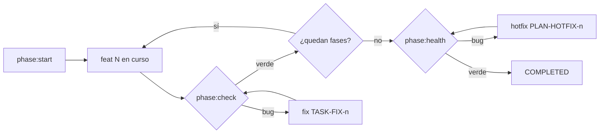
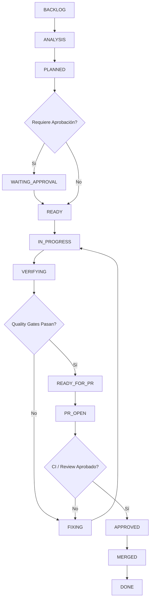

# 🤖 Agente Dev (`agt`)

[](https://github.com/Mathiiuk/agent_ASDW/actions/workflows/ci.yml)


> **CLI para que agentes de IA (Cursor, Claude, Windsurf, Cline, Antigravity) trabajen con el mismo rigor que un equipo de ingeniería:** cada tarea nace con su spec, su plan, su rama de Git y sus quality gates, y no se cierra hasta que pasan.

## ¿Qué problema resuelve?

Cuando un agente de IA escribe código sin un proceso, el resultado es difícil de revisar: cambios sin especificación, sin tests y mezclados en una misma rama. **Agente Dev** le impone un flujo de entrega estandarizado a cualquier proyecto existente con un solo comando (`agt init`).

| Capacidad | Cómo |
|---|---|
| **Trazabilidad** | `agt task:new` genera spec, plan, plan de pruebas, escenario Gherkin y manifiesto YAML, y crea la rama `<tipo>/<ID>-<slug>`. |
| **Quality gates** | `agt task:verify` ejecuta los comandos de test, lint y build declarados en el manifiesto y bloquea el avance si alguno falla. |
| **Bucle de verificación** | `agt task:loop` reintenta los gates, clasifica cada fallo (aserción, sintaxis, import, configuración) y acepta un `fixHandler` para que el agente aplique la corrección entre intentos. |
| **Desarrollo por fases** | `agt phase:*` encadena features (`feat → check → siguiente feat`), abre un `fix` si un check falla, corre un healthcheck final (con `hotfix` si falla) y documenta todo en la bitácora `docs/bitacora/`. |
| **Máquina de estados** | `PLANNED → IN_PROGRESS → VERIFYING → FIXING → READY_FOR_PR → DONE`, persistida en cada manifiesto. |
| **Integración con IDEs de IA** | Servidor **MCP** (`agt mcp`) y archivos de reglas para Cursor, Windsurf, Cline y Antigravity. |
| **Releases** | `agt release vX.Y.Z` consolida las tareas terminadas en un CHANGELOG. |
| **Memoria del proyecto** | Grafo de dependencias y registro de lecciones aprendidas consultable en pocos tokens. |

**Stack:** Node.js (ESM) · Commander · `@modelcontextprotocol/sdk` · js-yaml · Vitest · Cucumber/Gherkin · GitHub Actions (matriz Node 22/24) · pnpm

## Demo rápida

```bash
cd mi-proyecto && agt init                       # adopta el flujo en un repo existente
agt task:new AGT-0001 -t "Login con Google"      # spec + plan + rama feat/AGT-0001-login-con-google
agt task:verify AGT-0001                         # corre los quality gates
agt task:loop AGT-0001 --max-retries 3           # verifica, diagnostica y genera el reporte
agt release v1.0.0                               # changelog de lo terminado

# Desarrollo por fases: feat + check → siguiente feat, fix/hotfix y bitácora en docs/
agt phase:start PLAN-001 -t "Portal" -p "AGT-0002:Login" -p "AGT-0003:Dashboard"
agt phase:check                                  # repetir al terminar cada feat
agt phase:health                                 # healthcheck final
```

**Autor:** [Matias Krepchuk](https://www.linkedin.com/in/krepchuk-matias/) · Este repositorio se desarrolla con su propio flujo: ver `.agents/workflow/` (tareas AGT-0001 a AGT-0011).

---

## 📑 Tabla de Contenidos

- [Requisitos Previos](#-requisitos-previos)
- [Instalación](#-instalación)
- [Puesta en Marcha (Primeros Pasos)](#-puesta-en-marcha-primeros-pasos)
- [Guía de Uso de la CLI (`agt`)](#-guía-de-uso-de-la-cli-agt)
- [Estructura del Proyecto](#-estructura-del-proyecto)
- [Ciclo de Vida y Máquina de Estados](#-ciclo-de-vida-y-máquina-de-estados)
- [Quality Gates y Verificación](#-quality-gates-y-verificación)
- [Pruebas Unitarias y BDD](#-pruebas-unitarias-y-bdd-gherkin)
- [Actualizar el Agente](#-actualizar-el-agente)
- [Solución de Problemas](#-solución-de-problemas)

---

## ⚙️ Requisitos Previos

- **Node.js**: `>= 22` (el CI se prueba con Node 22 y 24; pnpm v11 requiere Node `>= 22.13`)
- **pnpm**: `>= 9.0.0` (gestor de paquetes oficial del proyecto). Si no lo tienes: `npm install -g pnpm` o `corepack enable`
- **Git**: `>= 2.30.0`
- *(Opcional)* Un IDE o cliente de IA compatible con MCP o con archivos de reglas: Cursor, Windsurf, Cline, Claude Code / Claude Desktop o Antigravity.

---

## 📦 Instalación

### 1. Clonar el Repositorio
```bash
git clone https://github.com/Mathiiuk/agent_ASDW.git
cd agent_ASDW
```

### 2. Instalar Dependencias con `pnpm`
```bash
pnpm install
```

Si `pnpm` solicita aprobación de scripts de compilación para dependencias nativas:
```bash
pnpm approve-builds --all
```

### 3. Enlazar la CLI Globalmente
Para poder ejecutar el comando `agt` o `agente-dev` desde cualquier terminal del sistema:

```bash
npm link
```
*(o alternativamente: `pnpm link --global`)*

Verifica la instalación ejecutando:
```bash
agt --version
agt --help
```

Si prefieres no enlazarla globalmente, puedes invocarla directamente desde el repositorio clonado:
```bash
node /ruta/a/agent_ASDW/bin/agente-dev.js --help
```

### 4. Verificar que todo funciona
Desde la carpeta del repositorio clonado:
```bash
pnpm test        # pruebas unitarias (Vitest)
pnpm test:bdd    # escenarios BDD (Cucumber)
```

---

## 🚀 Puesta en Marcha (Primeros Pasos)

Guía de punta a punta para poner el agente a trabajar en **tu** proyecto.

**1. Adoptar el flujo en tu proyecto**
```bash
cd /ruta/a/mi-proyecto
git init              # solo si todavía no es un repositorio Git
agt init
```
Esto crea `.agents/`, los archivos de reglas para IDEs (`AGENTS.md`, `.cursorrules`, `.windsurfrules`, `.clinerules`, `AI.md`), `cucumber.json`, el pipeline `.github/workflows/ci.yml`, tareas de VS Code, scripts `agt:*` en `package.json` y el hook pre-commit.

**2. Ajustar los quality gates a tu stack.** Las tareas nuevas usan por defecto `pnpm test` y `pnpm test:bdd`. Si tu proyecto usa otros comandos (npm, pytest, etc.), edita la sección `commands` del manifiesto `.agents/workflow/tasks/<ID>.yml`.

**3. Conectar tu IA**
- **Por reglas (todos los IDEs):** abre el proyecto en Cursor, Windsurf, Cline o Antigravity; leerán su archivo de reglas, que los dirige a `.agents/rules/master-workflow.md`.
- **Por MCP (recomendado):** registra el servidor `agt mcp` en tu cliente (ver [Servidor MCP](#11-servidor-mcp-para-inteligencia-artificial-agt-mcp)). Ejemplo con Claude Code:
  ```bash
  claude mcp add agente-dev -- agt mcp
  ```

**4. Primera tarea**
```bash
agt task:new AGT-0001 -t "Mi primera funcionalidad" --type feat   # crea artefactos + rama
# ... la IA (o tú) completa spec/plan, escribe tests y código ...
agt task:loop AGT-0001                                             # gates + reporte
```

**5. Desarrollo por fases (para entregas de varias features)**
```bash
agt phase:start PLAN-001 -t "Portal de clientes" -p "AGT-0002:Login" -p "AGT-0003:Dashboard"
agt phase:check     # al terminar cada feat: avanza o abre un fix
agt phase:health    # al final: completa el plan o abre un hotfix
```
Revisa y commitea la bitácora `docs/bitacora/PLAN-001.md` junto con el código. Para que la IA lo recorra sola de punta a punta, ver [Automatización Autónoma](#14-automatización-autónoma-de-punta-a-punta-agt-next--hook-stop).

**6. Mantener la memoria al día**
```bash
agt memory:sync     # regenera .agents/memory/context.md para que la IA tenga contexto barato
```

---

## 🛠️ Guía de Uso de la CLI (`agt`)

El CLI del agente automatiza el flujo de trabajo de desarrollo, la adopción en proyectos existentes y la gestión de ramas de Git.

### 1. Inicializar el Agente en cualquier proyecto existente (`agt init`)
Si tienes un proyecto existente (React, Node, Python, etc.) y deseas gobernarlo con este agente de workflow, sólo ingresa a su carpeta y ejecuta:

```bash
cd /ruta/hacia/tu-proyecto-existente
agt init
```

**¿Qué realiza `agt init`?**
- **Arquitectura Base**: Copia la estructura encapsulada en `.agents/` (`rules/`, `skills/`, `templates/`, `workflow/`).
- **Pipeline CI/CD**: Añade configuraciones de BDD (`cucumber.json`) y GitHub Actions listas para validaciones automáticas.
- **🚀 [NUEVO] Integración Universal de IA**: Genera automáticamente en la raíz los archivos de sistema para tu IDE favorito (`AGENTS.md` para Antigravity 2.0, `.cursorrules` para Cursor, `.windsurfrules` para Windsurf, `.clinerules` para Cline/VS Code y `AI.md` genérico). Todos redirigiendo a la misma regla maestra.
- **🚀 [NUEVO] Inyección de Comandos en tu IDE**: Añade scripts directos (`agt:task`, `agt:loop`, `agt:memory`) en el `package.json` para que aparezcan clickeables en la barra lateral de tu IDE, y crea las tareas nativas (Command Palette) en `.vscode/tasks.json`.
- Deja el proyecto completamente orquestado y listo para desarrollar.

---

### 2. Crear una nueva tarea y su rama de Git
Genera los 5 artefactos en `.agents/workflow/` (`tasks/`, `specs/`, `plans/`, `tests/`, `features/`) y **crea/conmuta automáticamente a la nueva rama de Git** con formato estandarizado (`<tipo>/<ID>-<slug>`):

```bash
# Ejemplo: Tarea de tipo feature
agt task:new AGT-0002 -t "Implementar nuevo validador de esquemas" --type feat

# Ejemplo: Tarea de tipo fix (corrección)
agt task:new AGT-0003 -t "Corregir manejo de rutas en Windows" --type fix
```

**Opciones disponibles para `task:new`:**
- `-t, --title <texto>` *(Obligatorio)*: Título descriptivo de la tarea.
- `--type <tipo>` *(Opcional)*: Tipo de tarea (`feat`, `fix`, `refactor`, `docs`, `test`, `chore`). Por defecto: `feat`.
- `--owner <nombre>` *(Opcional)*: Responsable o equipo asignado. Por defecto: `team-agent`.
- `--base <rama>` *(Opcional)*: Rama base de origen. Por defecto: `main`.
- `--no-branch` *(Opcional)*: Genera los archivos sin crear ni conmutar a una nueva rama de Git.

---

### 3. Conmutar a la rama de una tarea existente
Calcula el nombre de la rama a partir del manifiesto de la tarea y cambia a ella (creándola si no existía localmente):

```bash
agt task:branch AGT-0001
```

---

### 4. Verificar Quality Gates de una tarea
Valida la estructura del manifiesto YAML y ejecuta automáticamente los comandos de prueba, lint o build configurados:

```bash
agt task:verify AGT-0001
```

---

### 5. Ejecutar el bucle de verificación (Self-Healing Loop)
Ejecuta el ciclo cerrado: evalúa los quality gates, clasifica la causa de cada fallo, reintenta hasta el límite configurado y genera el reporte final en `.agents/workflow/executions/<ID>.md`. La corrección entre intentos la aplica el agente de IA (vía MCP) o una función `fixHandler` pasada a `runTaskLoop()`; la CLI se encarga de verificar y documentar:

```bash
# Ejecutar bucle con 3 reintentos por defecto
agt task:loop AGT-0003

# O con alias y límite personalizado
agt task:run AGT-0003 --max-retries 5
```

---

### 6. Listar todas las tareas del workflow
Muestra el listado de todas las tareas registradas en el proyecto y su estado actual:

```bash
agt task:list
```

---

### 7. Consultar o actualizar el estado de una tarea
```bash
# Consultar estado actual
agt task:status AGT-0001

# Actualizar estado a IN_PROGRESS, READY_FOR_PR, DONE, etc.
agt task:status AGT-0001 IN_PROGRESS
agt task:status AGT-0001 DONE
```

---

### 8. Memoria Graphify (Ahorro de Tokens y Prevención de Errores)
Construye y consulta el Grafo de Conocimiento del proyecto y la memoria de lecciones aprendidas:

```bash
# Sincronizar y reconstruir el grafo de dependencias y context.md
agt memory:sync

# Consultar contexto y dependencias específicas en pocos tokens
agt memory:query "auth"

# Registrar una lección aprendida o trampa a evitar
agt memory:learn -l "Evitar N+1 queries en turnos" -c "PERFORMANCE" -s "Usar inner join con índices"
```

---

### 9. Gestor de Releases y Auto-Changelog (`agt release`)
Cuando finalices un sprint o un hito, consolida tus tareas completadas (`status: DONE`) en una nueva versión limpia y profesional.

```bash
# Generar la versión v1.0.0
agt release v1.0.0
```

**¿Qué sucede automáticamente?**
1. Escanea las tareas finalizadas y las agrupa por categoría (🚀 Features, 🐛 Fixes, 📦 Mantenimiento).
2. Genera y actualiza tu archivo `CHANGELOG.md` en la raíz del proyecto.
3. Actualiza el número de versión directamente en tu `package.json`.
4. Etiqueta los manifiestos procesados (`released_in: v1.0.0`) para no duplicarlos en la próxima versión.

---

### 10. Auto-Scaffolding BDD (`agt test:scaffold`)
Acelera el desarrollo guiado por comportamiento (TDD/BDD). El CLI lee tus especificaciones en lenguaje natural y te genera el esqueleto de código (Step Definitions).

```bash
agt test:scaffold AGT-0001
```

**Ejemplo de uso:**
Si tu archivo `.agents/workflow/features/AGT-0001.feature` contiene:
> *Given un usuario en la base de datos*

El CLI generará el archivo JS listo para programar en `tests/bdd/steps/AGT-0001.steps.js`:
```javascript
import { Given, When, Then } from '@cucumber/cucumber';
import assert from 'node:assert';

Given('un usuario en la base de datos', async function () {
  // TODO: Implementar el paso
});
```

---

### 11. Servidor MCP para Inteligencia Artificial (`agt mcp`)
**Model Context Protocol (MCP)** permite que IDEs modernos (Antigravity 2.0, Cursor, Claude Desktop, Cline) operen el ciclo de vida completo del workflow de forma nativa (sin depender de interpretar texto de consola ni de que el usuario ejecute comandos manualmente).

```bash
# Iniciar el servidor (Usa la entrada/salida estándar stdio)
agt mcp
```

**¿Cómo conectarlo a tu IDE de IA (Ej. Cursor o Claude Desktop)?**
Agrega la siguiente configuración en tu panel de herramientas MCP o en tu archivo `claude_desktop_config.json`:
```json
{
  "mcpServers": {
    "agente-dev": {
      "command": "agt",
      "args": ["mcp"]
    }
  }
}
```
*Nota:* `"command": "agt"` requiere haber enlazado la CLI (`npm link`). Si no, usa `"command": "node"` con `"args": ["/ruta/a/agent_ASDW/bin/agente-dev.js", "mcp"]`. El servidor opera sobre el directorio desde donde el cliente lo lanza. Si tu cliente lo lanza desde otro lugar (por ejemplo Claude Desktop), fija la raíz del proyecto con la variable `AGT_PROJECT_ROOT`:
```json
{ "mcpServers": { "agente-dev": { "command": "agt", "args": ["mcp"], "env": { "AGT_PROJECT_ROOT": "/ruta/a/mi-proyecto" } } } }
```
Además, toda tool acepta un argumento opcional `projectRoot` (prioridad: `projectRoot` > `AGT_PROJECT_ROOT` > directorio actual). En la CLI, el equivalente es `agt --root /ruta/a/mi-proyecto <comando>`.

**Herramientas expuestas (acción, no solo lectura):**

| Herramienta | Equivalente CLI | Propósito |
|---|---|---|
| `list_active_tasks` | `task:list` | Listar todas las tareas del workflow |
| `get_task` | `task:status <id>` | Leer el manifiesto completo de una tarea |
| `create_task` | `task:new` | Crear una tarea nueva y su rama de Git |
| `update_task_status` | `task:status <id> <status>` | Cambiar el estado de una tarea |
| `checkout_task_branch` | `task:branch` | Conmutar/crear la rama Git de una tarea |
| `verify_task_quality_gates` | `task:verify` | Validar manifiesto y correr los Quality Gates |
| `run_self_healing_loop` | `task:loop` | Ejecutar los gates y devolver diagnóstico estructurado |
| `record_lesson` | `memory:learn` | Registrar una lección/trampa evitada |
| `sync_knowledge_graph` | `memory:sync` | Reconstruir el grafo de conocimiento |
| `query_graphify_memory` | `memory:query` | Consultar contexto y lecciones por palabra clave |
| `generate_release` | `release` | Consolidar tareas DONE en un CHANGELOG |
| `generate_bdd_scaffold` | `test:scaffold` | Generar Step Definitions desde un `.feature` |
| `start_phased_plan` | `phase:start` | Activar el modo por fases con features ordenadas |
| `check_current_phase` | `phase:check` | Check de la feat actual: avanza o abre un fix con diagnóstico |
| `run_final_healthcheck` | `phase:health` | Healthcheck final: completa el plan o abre un hotfix |
| `get_phased_plan` | `phase:status` | Estado del plan, fixes/hotfixes y registro de eventos |
| `resume_phased_plan` | `phase:resume` | Reanudar un plan bloqueado por límite de intentos |
| `next_step` | `next` | **Siguiente acción concreta** del flujo (ver sección 14) |

*Impacto:* el agente de IA conectado obtiene control real sobre el flujo — crea la tarea, escribe el código, llama a `verify_task_quality_gates`/`run_self_healing_loop`, lee el diagnóstico estructurado (categoría + sugerencia por gate fallido), corrige el código con sus propias herramientas de edición, y vuelve a invocar la herramienta hasta que todo pase. Ese ciclo de "ejecutar → diagnosticar → corregir → reverificar" impulsado por el propio agente de IA es lo que lo convierte en un flujo de trabajo autónomo real, en vez de un simple generador de plantillas.

---

### 12. El Guardián Automático (Git Pre-Commit Hook)
No requiere configuración manual. Al ejecutar `agt init`, el framework instala un hook inteligente en tu sistema (`.git/hooks/pre-commit`).

Si estás trabajando en la rama de una tarea (ej. `feat/AGT-0021`) e intentas hacer `git commit`, el guardián congelará el commit y ejecutará los Quality Gates (`agt task:verify AGT-0021`). 
- **Si todo pasa 🟢:** El commit se aprueba.
- **Si hay errores 🔴:** El commit **es bloqueado** instantáneamente, y te pedirá ejecutar el bucle de auto-corrección (`agt task:loop`) garantizando que jamás subas código roto al repositorio.

---

### 13. Modo de Desarrollo por Fases (`agt phase:*`)
Divide un desarrollo grande en features secuenciales. Cada feat se valida con un **check** antes de pasar a la siguiente; si aparece un bug se abre un **fix**, y al final se corre un **healthcheck** global (si falla, se abre un **hotfix**). Todo queda registrado en la bitácora `docs/bitacora/<PLAN-ID>.md`.

```bash
# Activa el modo por fases (las tareas feat se crean si no existen)
agt phase:start PLAN-001 -t "Portal de clientes" -p "AGT-0012:Login con OAuth" -p "AGT-0013:Dashboard"

# Al terminar la feat actual: check → avanza a la siguiente o abre AGT-0012-FIX-1
agt phase:check

# Con todas las fases en verde: healthcheck final → COMPLETED o abre PLAN-001-HOTFIX-1
agt phase:health

# Estado del plan activo
agt phase:status
```
*Opcional:* `--health "unit_tests=pnpm test" --health "build=pnpm build"` define los comandos del healthcheck final (por defecto `pnpm test` y `pnpm test:bdd`).



**Reglas del flujo:**
- Solo puede haber un plan activo a la vez; las features se trabajan en la rama activa (sin rama por fase).
- No se avanza a la siguiente feat mientras la fase tenga un fix abierto; un nuevo fallo reutiliza el mismo fix.
- El healthcheck solo se puede ejecutar cuando todas las fases están en verde.
- La bitácora `docs/bitacora/<PLAN-ID>.md` se regenera en cada paso con: tabla de fases, fixes/hotfixes con diagnóstico, resultado del healthcheck y registro cronológico. El estado interno vive en `.agents/workflow/phases/`.
- **Límite de intentos:** tras `--max-attempts` checks fallidos consecutivos (por defecto 3) en una fase o en el healthcheck, el plan pasa a `BLOCKED` y espera intervención humana. Se reanuda con `agt phase:resume -n "qué se cambió"`.

---

### 14. Automatización Autónoma de Punta a Punta (`agt next` + hook Stop)
Objetivo: darle a la IA una meta y que trabaje sola hasta `COMPLETED`, o hasta un bloqueo documentado.

**1. `next_step` / `agt next`: qué hacer ahora.** Lee el estado del plan y devuelve una única acción con todo su contexto:

```bash
agt next          # legible
agt next --json   # para la IA, hooks y scripts
```
```json
{ "action": "FIX_BUG", "task": "AGT-0012-FIX-1", "diagnosis": "[ASSERTION_FAILURE] unit_tests",
  "artifacts": { "report": ".agents/workflow/executions/AGT-0012.md", "...": "..." },
  "tool": "check_current_phase", "cli": "agt phase:check", "done": false }
```
Acciones posibles: `IMPLEMENT_FEATURE`, `FIX_BUG`, `RUN_HEALTHCHECK`, `FIX_HOTFIX`, `BLOCKED`, `DONE` y `NO_ACTIVE_PLAN`. La IA solo repite el bucle: llama a `next_step`, ejecuta la acción e invoca la tool indicada, hasta recibir `done: true`.

**2. Hook Stop (Claude Code): no termina antes de tiempo.** `agt init` (o `agt hook:install`) registra en `.claude/settings.json`:
```json
{ "hooks": { "Stop": [ { "hooks": [ { "type": "command", "command": "agt hook:stop" } ] } ] } }
```
Cuando la IA intenta terminar su turno con el plan sin completar, el hook responde `{"decision": "block", "reason": "..."}` con la siguiente acción, y la IA continúa sola.

Salvaguardas contra bucles y gasto de tokens:
- Se permite detenerse con el plan `COMPLETED` o `BLOCKED`, o sin plan activo.
- Si la IA recibe `--max-idle` avisos seguidos (por defecto 2) sin ejecutar ningún check, el hook deja de bloquear.
- Ante cualquier error interno, el hook nunca impide detenerse.

**3. Ejecución desatendida (ejemplo con Claude Code):**
```bash
claude -p "Usando el modo por fases de agt, implementa: portal de clientes con login y dashboard. Trabaja con agt next hasta terminar." --permission-mode acceptEdits
```

---

## 📂 Estructura del Proyecto

```text
agente_dev/
├── .agents/                       # Ecosistema completo del agente (encapsulado)
│   ├── rules/                     # Reglas maestras de flujo (Director Técnico)
│   ├── skills/                    # Habilidades especializadas del agente
│   ├── templates/                 # Plantillas de manifiestos, specs, planes y BDD
│   ├── workflow/                  # Artefactos generados por cada tarea
│   │   ├── tasks/                 # Manifiestos YAML (<ID>.yml)
│   │   ├── specs/                 # Especificaciones técnicas (<ID>.md)
│   │   ├── plans/                 # Planes de desarrollo (<ID>.md)
│   │   ├── tests/                 # Matrices de prueba (<ID>.md)
│   │   ├── features/              # Especificaciones BDD Gherkin (<ID>.feature)
│   │   ├── executions/            # Reportes de ejecución (<ID>.md)
│   │   └── phases/                # Estado de los planes por fases (<PLAN-ID>.yml)
│   ├── memory/                    # Grafo de conocimiento, context.md y lecciones
│   └── examples/                  # Ejemplos de adaptación y manifiestos
├── bin/                           # Punto de entrada ejecutable de la CLI (agt)
├── docs/bitacora/                 # Bitácoras del modo por fases (<PLAN-ID>.md)
├── features/                      # Especificaciones BDD globales del sistema
├── src/                           # Código fuente del motor del agente
│   ├── git.js                     # Integración con Git y cálculo de ramas
│   ├── task-manager.js            # Gestor de tareas y plantillas
│   ├── validator.js               # Validador de manifiestos y Quality Gates
│   ├── workflow-runner.js         # Motor de bucle autónomo y diagnóstico
│   ├── phase-runner.js            # Modo de desarrollo por fases y bitácora
│   ├── memory.js                  # Memoria Graphify (grafo y lecciones)
│   ├── mcp-server.js              # Servidor MCP (herramientas para IAs)
│   ├── release-manager.js         # Releases y CHANGELOG
│   ├── scaffolder.js              # Scaffolding de Step Definitions BDD
│   ├── init.js                    # Inicializador de proyectos (agt init)
│   └── index.js                   # Exportaciones de la librería
├── tests/                         # Suite de pruebas unitarias (Vitest) y BDD
│   └── bdd/steps/                 # Step Definitions en JavaScript para Cucumber
├── cucumber.json                  # Configuración centralizada de Cucumber.js
├── package.json                   # Configuración del paquete y scripts
└── README.md                      # Documentación principal del sistema
```

---

## 🔄 Ciclo de Vida y Máquina de Estados

Toda tarea procesada por el agente sigue una progresión estricta:



---

## 🛡️ Quality Gates y Verificación

Cada tarea contiene un archivo de manifiesto YAML (`.agents/workflow/tasks/<ID>.yml`) donde se especifican los gates obligatorios:

```yaml
id: AGT-0002
title: "Integracion de Motor BDD con Gherkin y Cucumber"
type: feat
status: READY_FOR_PR
quality_gates:
  unit_tests: true
  bdd_tests: true
  smoke_tests: true
commands:
  install: "pnpm install"
  unit_tests: "pnpm test"
  bdd_tests: "pnpm test:bdd"
  smoke_tests: "node ./bin/agente-dev.js --help"
```

El comando `agt task:verify <ID>` se asegura de que:
1. El manifiesto cumpla con todos los campos obligatorios.
2. Cada gate activo (`true`) tenga un comando asociado en `commands`.
3. Todos los comandos retornen código de salida `0` (éxito).

---

## 🧪 Pruebas Unitarias y BDD (Gherkin)

El proyecto cuenta con un doble motor de validación automatizada:

### 1. Pruebas Unitarias con Vitest
```bash
# Ejecutar todas las pruebas unitarias
pnpm test

# Modo observador (watch)
pnpm run test:watch
```

### 2. Pruebas de Comportamiento BDD con Cucumber y Gherkin
```bash
# Ejecutar la suite de especificaciones BDD (.feature)
pnpm test:bdd
```

---

## 🔁 Actualizar el Agente

Si instalaste desde el repositorio clonado y lo enlazaste con `npm link`, basta con actualizar el clon (el enlace apunta a él):

```bash
cd /ruta/a/agent_ASDW
git pull
pnpm install
```

Para llevar las reglas, skills y plantillas nuevas a un proyecto que ya usa el agente, vuelve a ejecutar `agt init` en ese proyecto. Sobrescribe `.agents/rules`, `.agents/skills`, `.agents/templates` y `.agents/examples`, pero **no** toca tus tareas (`.agents/workflow/`), tu memoria (`.agents/memory/`) ni los archivos de reglas de IDE, CI, tareas de VS Code o hooks que ya existan (para regenerarlos, bórralos antes).

---

## 🩺 Solución de Problemas

| Síntoma | Solución |
|---|---|
| `agt: command not found` | Ejecuta `npm link` en el repositorio clonado o usa `node /ruta/a/agent_ASDW/bin/agente-dev.js`. |
| `pnpm install` falla por versión de Node | pnpm v11 requiere Node `>= 22.13`. Actualiza Node. |
| pnpm pide aprobar scripts de compilación | `pnpm approve-builds --all`. |
| Un commit queda bloqueado por el hook | Estás en la rama de una tarea y sus gates fallan: corre `agt task:loop <ID>` y corrige. |
| `phase:check` dice que el modo no está activo | Inícialo con `agt phase:start`, o pasa el ID: `agt phase:check PLAN-001`. |
| `phase:health` dice que hay fases sin check | Ejecuta `agt phase:check` hasta que todas las fases estén en verde. |
| El plan quedó `BLOCKED` | Se alcanzó el límite de intentos. Revisa el reporte de la fase y el diagnóstico en la bitácora, corrige y ejecuta `agt phase:resume -n "..."`. |
| Claude Code no se detiene | El hook Stop detectó trabajo pendiente: mira `agt next`. Para desactivarlo, quita `agt hook:stop` de `.claude/settings.json`. |
| El cliente MCP no ve herramientas | Verifica que `agt mcp` arranque sin errores en una terminal y que el cliente se abra en la raíz del proyecto. |

---

## 💡 Principio de Aprendizaje y Código Limpio

El código está documentado con JSDoc en español en cada función pública, y los comentarios en línea se reservan para explicar decisiones no obvias (por ejemplo, el manejo de *detached HEAD* en GitHub Actions).

## 📄 Licencia

MIT © Matias Krepchuk
